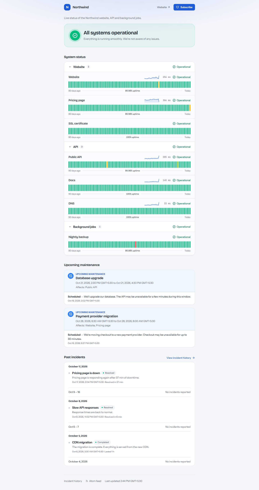
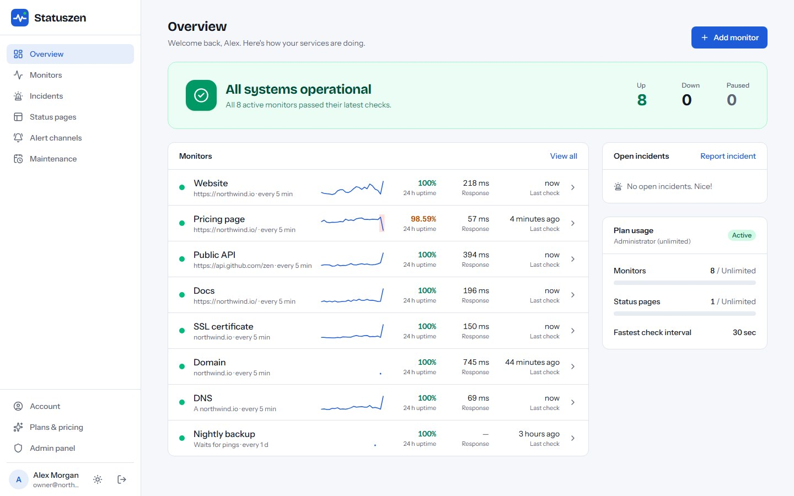
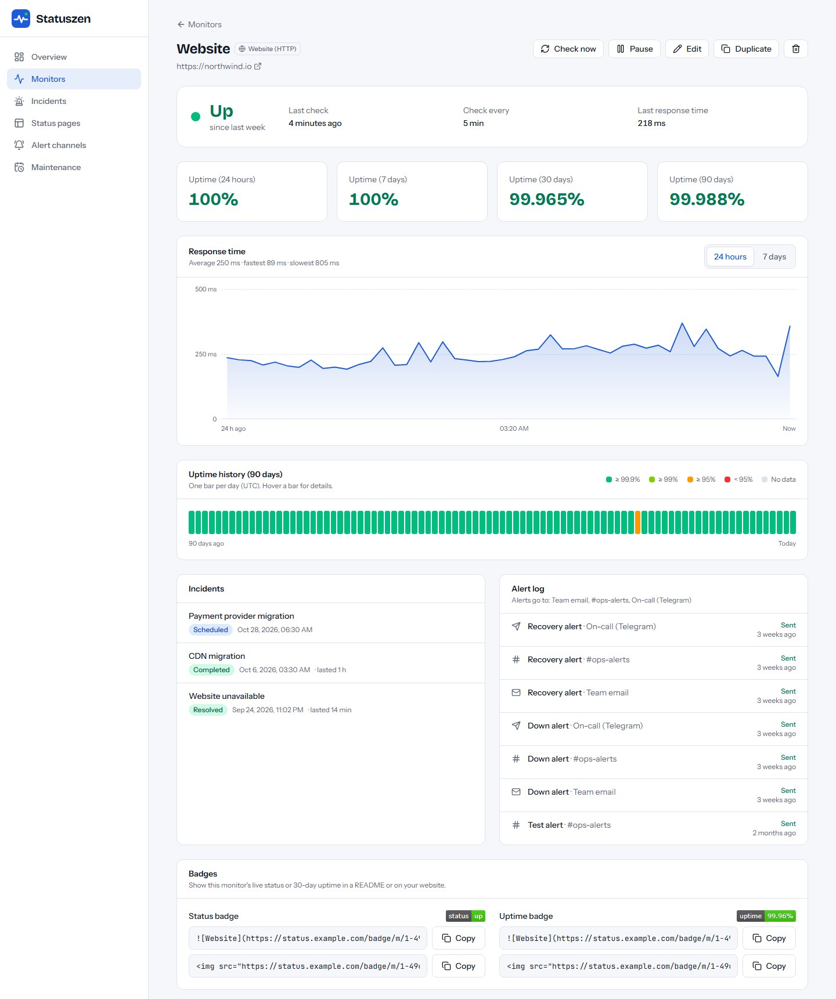
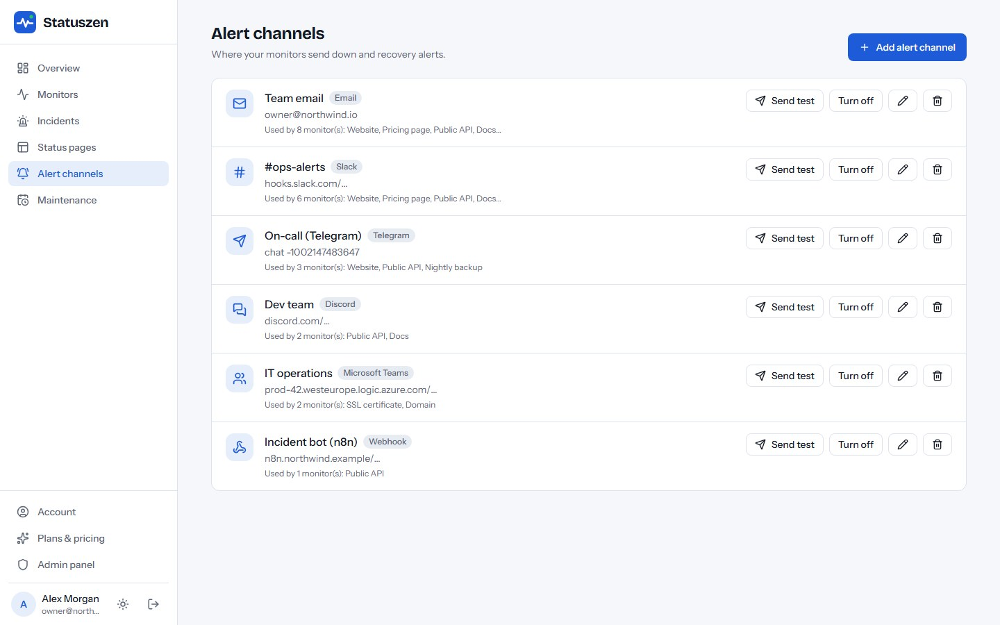
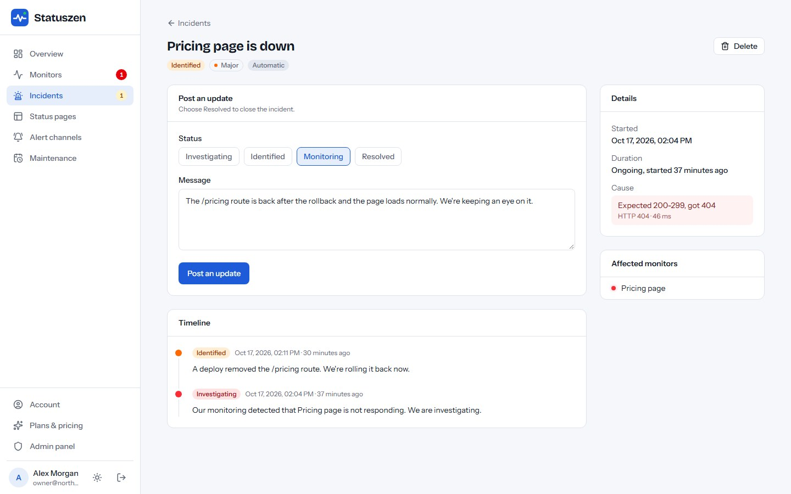
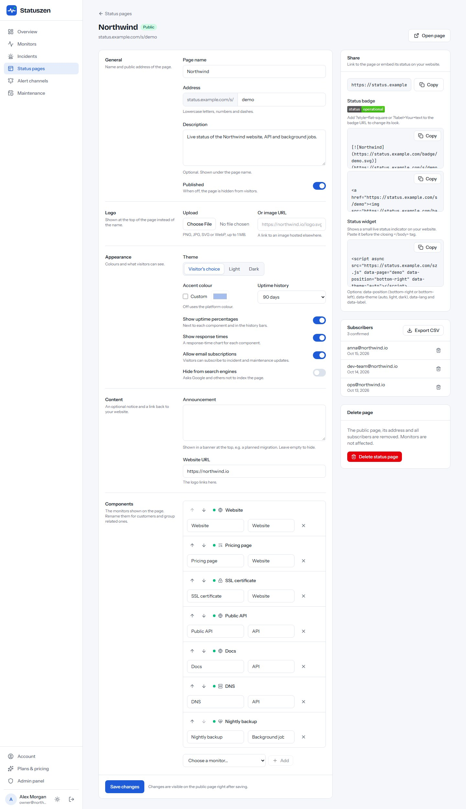
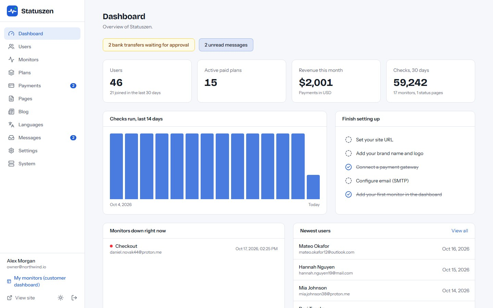

# Statuszen

**Open-source uptime monitoring, public status pages and cron job (heartbeat) monitoring — as a
self-hosted SaaS.** Built with Next.js 16, React 19 and Tailwind CSS 4. Runs on a VPS, Docker,
cPanel (Node.js) or Vercel, with MySQL/MariaDB or a zero-setup SQLite database.

**Live demo:** https://statuszen.vercel.app — log in with `demo@statuszen.app` / `demo12345`
(data resets regularly).



## Features

- **7 monitor types:** HTTP(S), keyword, TCP port, SSL certificate expiry, domain expiry (RDAP),
  DNS record and heartbeat (cron job) monitors, down to 30-second intervals with the worker.
- **Alerts:** email, signed webhooks, Slack, Discord, Microsoft Teams and Telegram, with 1–5
  confirmations before an alert, "still down" reminders and recovery alerts.
- **Status pages:** branded public pages with 90-day uptime bars, incidents and updates,
  maintenance windows, email subscribers (double opt-in), Atom feed and dark mode.
- **Embeds:** SVG badges, a 2 KB status widget (`sz.js`) and a public JSON API.
- **SaaS ready:** customer accounts, plans with limits, Stripe / PayPal / Razorpay / bank
  transfer payments, a blog and a full admin panel.
- **Multi-language** with right-to-left support (Arabic and Hindi packs included).
- **Web installer** — no command line needed on shared hosting.

| Dashboard | Monitor detail | Alert channels |
| --- | --- | --- |
|  |  |  |
| **Incidents** | **Status page builder** | **Admin panel** |
|  |  |  |

More screenshots are in [`marketing/final/screenshots`](marketing/final/screenshots).

## Hosted version & paid installation

Need Statuszen hosted for you, installed on your own server, or customised? See
**[EpiFive services](https://www.epifive.com/services#custom-app-development)** (also
[managed IT support](https://www.epifive.com/services#managed-it-support)).

- Step-by-step guide: [Statuszen — open-source uptime monitor & status page](https://www.epifive.com/blog/statuszen-open-source-uptime-monitor-status-page)
- More open-source projects: [epifive.com/open-source](https://www.epifive.com/open-source)

## Quick start

```bash
git clone https://github.com/epifive/statuszen.git
cd statuszen/app
npm install
npm run dev
```

Open http://localhost:3000 — you are redirected to the web installer at `/install`. Choose
**SQLite** for a zero-setup local database, or **MySQL/MariaDB** for production.

Production, Docker, PM2, cPanel and Vercel setups, the check scheduler (lazy mode, cron URL or
worker) and every setting are covered in [`app/README.md`](app/README.md) and the full guide in
[`documentation/index.html`](documentation/index.html) (open it in a browser).

**Requirements:** Node.js 20.9+ (22.13+ for SQLite), MySQL 5.7+ / MariaDB 10.3+ or SQLite, HTTPS
and outbound internet access for the checks.

## Repository layout

| Path | What |
| --- | --- |
| `app/` | The Next.js application (dashboard, status pages, admin, installer, worker) |
| `documentation/` | Full user and admin guide (single HTML file) |
| `marketing/` | Screenshot and preview scripts and the final screenshots |

## Contributing

Bug reports and pull requests are welcome — please open an
[issue](https://github.com/epifive/statuszen/issues) first for larger changes. Run
`npm run lint` and `npm run build` in `app/` before sending a PR.

## License

[MIT](LICENSE) © 2026 EpiFive
